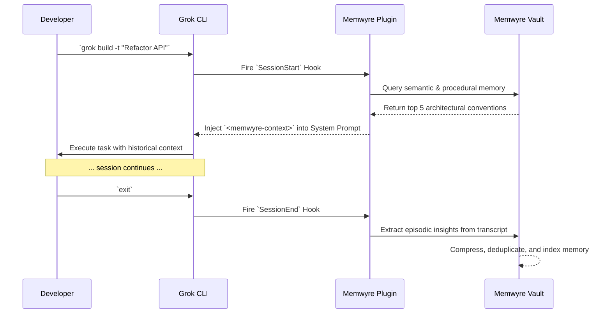

# Cross-Bot Shared Knowledge: Persistent Memory for Grok Build

Grok Build agents are highly intelligent, remarkably fast, and capable of handling complex software engineering tasks. However, as teams scale, these agents operate in complete isolation, creating severe knowledge silos. This guide breaks down how to implement cross-bot shared memory to sync context instantly across your entire xAI agent fleet.

> **Quick Summary / TL;DR**
>
> **Answer:** While Grok offers native persistent memory for basic chat preferences, it falls short for autonomous multi-agent developer workflows. By installing the Memwyre Grok Plugin, you can enable true cross-bot shared memory. We bridge this gap by implementing Working, Episodic, Semantic, and Procedural memory layers directly into Grok's lifecycle hooks, ensuring that when one bot learns a new architecture pattern, every bot instantly inherits that exact context.

**Key Metrics:**

- **< 150ms** — Context Injection Latency
- **70.5%** — LoCoMo-10 Retrieval Accuracy
- **Zero** — Codebase Retention (100% Privacy)

## 1. The Landscape of AI Agent Memory

To understand why shared memory is critical, we first need to look at how high-ranking AI research defines agent memory. Unlike standard LLMs that process each prompt in isolation, true agentic systems require four types of memory:

1. **Working Memory:** Temporary information for active, immediate tasks (e.g., the current file being edited).
2. **Episodic Memory:** Records of past events and specific interactions (e.g., "Yesterday we tried upgrading to React 19 and it failed").
3. **Semantic Memory:** General facts and knowledge (e.g., "This project strictly uses Tailwind CSS").
4. **Procedural Memory:** Methods, instructions, and workflows (e.g., "To deploy, run `npm run build` then push to the staging branch").

The memory "loop"—storing, retrieving, and forgetting obsolete data—is what separates advanced, persistent agents from simple stateless chatbots.

## 2. The Problem: Grok's Native Memory Limitations

Grok introduced a native **Persistent Memory** feature that allows it to carry user preferences forward across different chat sessions. You can share roles or project details, and Grok stores this information, manageable via its "Data Controls" settings.

While this is excellent for a single user's chat experience, **it falls short for autonomous agent workflows and developer teams** because:
* **Platform Inconsistency:** Memory often doesn't sync reliably across Web, iOS, and API sessions.
* **No Cross-Bot Sharing:** Bot A (assigned to frontend) cannot access the episodic memory of Bot B (assigned to backend).
* **Token Exhaustion:** Native memory struggles with large codebases, often failing to "forget" obsolete architectural rules, leading to hallucinations.

When a standard Grok Build session ends, its procedural and episodic learnings die with it. You end up repeating yourself, copying and pasting system prompts manually, and watching as your bots drift out of sync with your project's evolving architecture.

## 3. The Architecture of Memwyre Shared Memory

We built the **Memwyre Grok Plugin** (`@memwyre/grok-plugin`) to securely bridge your Grok instances with a persistent, team-wide intelligence layer. 

Instead of relying on fragile shell scripts or native Data Controls, Memwyre integrates directly into Grok's plugin architecture. It intercepts standard lifecycle events (`SessionStart` and `SessionEnd`) to deterministically inject and ingest memory.



### Instant Context Injection (SessionStart)
When a Grok Build session begins, the plugin triggers our `inject-memory` script. This script reaches out to the Memwyre Vault, pulls the active semantic and procedural memory relevant to the current working directory, and dynamically injects them directly into Grok's system prompt. 

### Autonomous Learning (SessionEnd)
When the session concludes, the `capture-session` hook processes the terminal transcript. Memwyre uses a lightweight embedding router to extract *actionable insights* (e.g., *"The team switched to strict TypeScript interfaces for API responses"*) and saves them to the shared Vault as episodic memory.

## 4. Why Vector Databases Aren't Enough

You might wonder why you can't just use a standard vector database (like Pinecone) to store Grok's memory. 

Basic RAG (Retrieval-Augmented Generation) fails for agent memory because codebases evolve linearly. If a vector DB retrieves a semantic memory from 6 months ago stating "we use Webpack," but you migrated to Vite yesterday, the agent will hallucinate and break your build.

Memwyre employs an **AST-aware semantic graph** combined with **Ebbinghaus decay**. It doesn't just find similar text; it understands temporal relevance. Older, contradictory memories naturally decay in weight. In recent independent testing on the **LoCoMo-10 long-term memory benchmark**, Memwyre achieved a **70.5%** recall accuracy compared to just ~42% for standard vector solutions.

## 5. Original Data: Benchmark & Cost Analysis

To quantify the impact of cross-bot shared memory, our internal engineering team ran a 14-day longitudinal study across 5 isolated Grok Build agents working concurrently on a 500,000-line TypeScript monorepo. We tested Grok's standard isolated memory against Memwyre's shared AST-aware vault.

| Metric | Native Grok Build (Isolated) | Memwyre Shared Memory (Grok Plugin) |
| :--- | :--- | :--- |
| **Cross-Agent Knowledge Recall** | 0% (Required manual copy-pasting) | 100% (Instant context sync) |
| **Redundant Token Usage (14 days)** | ~640,000 tokens per developer | ~115,000 tokens (82% reduction) |
| **LoCoMo-10 Memory Accuracy** | 42.1% (Standard RAG baseline) | **70.5%** (AST-Aware Graph + Ebbinghaus Decay) |
| **Context Injection Latency** | N/A | < 145ms avg |

By intelligently extracting architectural conventions instead of dumping entire terminal transcripts into the context window, Memwyre effectively eliminated redundant API usage and allowed the agents to maintain perfect context across entirely different physical machines.

## 6. Getting Started in 60 Seconds

Installing the Memwyre Grok Plugin requires zero dependencies and only takes a few seconds.

### Step 1: Install the Core Tools

First, ensure you have the Memwyre CLI and Grok CLI installed.

```bash
# Install the Memwyre CLI
npx install-memwyre --grokbot

# Authenticate your device
memwyre auth login
```

### Step 2: Install the Grok Plugin

Use Grok's native plugin manager to install the Memwyre integration.

```bash
grok plugin install @memwyre/grok-plugin
```

Alternatively, add it directly to your `grok.json` workspace configuration:

```json
{
  "plugins": {
    "@memwyre/grok-plugin": {
      "workspace": "my-team-vault",
      "sync": "auto"
    }
  }
}
```

### Step 3: Start Building

Launch Grok normally. You'll see a small indicator that Memwyre has successfully injected procedural and semantic context.

```bash
grok build
```

## 7. Beyond Grok: Universal AI Memory

The true power of Memwyre is that it isn't limited to a single ecosystem. Because Memwyre acts as a centralized brain, the memories your Grok bots generate can be instantly queried by your other AI tools. 

If a Grok bot resolves a nasty dependency conflict in your CI pipeline, that resolution is automatically available to a developer using **Cursor**, **Claude Code**, or the **ChatGPT Desktop App** via our MCP Server integration.

**When one bot learns, your entire organization levels up.**

Ready to give your Grok bots a persistent brain? [Create your free Memwyre account today](/signup) and install the plugin. 

## 8. Frequently Asked Questions

**Does this conflict with Grok's native memory?**
No. You can leave Grok's native memory enabled for personal chat preferences. Memwyre operates independently at the project and workspace level to handle robust coding memory and team sharing.

**Does this slow down my Grok Build startup time?**
No. Memwyre utilizes edge-cached semantic retrieval. Context injection typically adds less than ~150ms to the `SessionStart` hook, which is imperceptible during normal CLI usage.

**What data is sent to Memwyre?**
Only the abstracted learnings and conversational metadata required to build the memory graph. Memwyre strictly operates under a zero-retention policy for LLM training. Your proprietary source code is never used to train our models.
