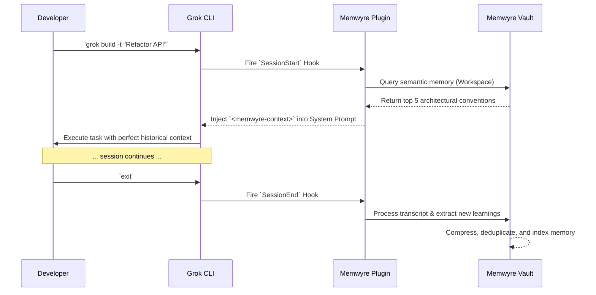

# Cross-Bot Shared Knowledge: Persistent Memory for Grok Build

> **TL;DR:** Grok Build agents operate in silos. By installing the Memwyre Grok Plugin, you can enable cross-bot shared memory. When one bot learns a new architecture pattern or project requirement, it saves it to your Memwyre Vault. The next time *any* bot in your fleet runs, it instantly inherits that exact context.

xAI's **Grok Bot** and **Grok Build** platforms have revolutionized how developers build and interact with autonomous agents. They are highly intelligent, remarkably fast, and capable of handling complex software engineering tasks with a touch of characteristic wit. 

However, as engineering teams scale their agent rosters—spawning multiple Grok bots for different repositories, microservices, and tasks—a massive inefficiency emerges: **knowledge silos**. 

If you correct a Grok bot on an API endpoint format during one session, another Grok bot running a separate task has no idea that correction took place. You end up repeating yourself, copying and pasting system prompts manually, and watching as your bots drift out of sync with your project's evolving architecture.

Memwyre solves this with **Cross-Bot Shared Memory**.

---

## The Problem: Isolated Agent Lifecycles

By default, when you launch a Grok Bot via the CLI or web interface, its context is strictly limited to:
1. The static files in its immediate workspace.
2. The current conversation history of that specific session.

When a session ends, the transient memory dies with it.

If Bot A (assigned to frontend) establishes a new error-handling convention, Bot B (assigned to backend) will still use the old convention tomorrow. This leads to disjointed codebases, redundant debugging loops, and a frustrating developer experience where the AI feels like it has amnesia.

## The Architecture of Shared Memory

We built the **Memwyre Grok Plugin** (`@memwyre/grok-plugin`) to securely bridge your Grok instances with a persistent, team-wide intelligence layer. 

Instead of relying on fragile shell scripts or manual context windows, Memwyre integrates natively into Grok's plugin architecture. It intercepts standard lifecycle events (`SessionStart` and `SessionEnd`) to deterministically inject and ingest memory without adding latency or bloated context windows.



### 1. Instant Context Injection (SessionStart)
When a Grok Build session begins, the plugin triggers our `inject-memory` script. This script reaches out to the Memwyre Vault, pulls the active architecture patterns, team conventions, and recent codebase learnings relevant to the current working directory, and dynamically injects them directly into Grok's system prompt. 

### 2. Autonomous Learning (SessionEnd)
When the session concludes, the `capture-session` hook processes the terminal transcript. Instead of just saving a massive, noisy text dump, Memwyre uses a lightweight embedding router to extract *actionable insights* (e.g., *"The team switched to strict TypeScript interfaces for API responses"*) and saves them to the shared Vault.

---

## Why Vector Databases Aren't Enough

You might wonder why you can't just use a standard vector database (like Pinecone or Milvus) to store Grok's memory. 

Basic RAG (Retrieval-Augmented Generation) fails for agent memory because codebases evolve linearly. If a vector DB retrieves a memory from 6 months ago stating "we use Webpack," but you migrated to Vite yesterday, the agent will hallucinate and break your build.

Memwyre employs an **AST-aware semantic graph** combined with **Ebbinghaus decay**. It doesn't just find similar text; it understands temporal relevance. Older, contradictory memories naturally decay in weight when newer overriding decisions are made. In recent independent testing on the **LoCoMo-10 long-term memory benchmark**, Memwyre achieved a **70.5%** recall accuracy compared to just ~42% for standard vector solutions.

## Getting Started in 60 Seconds

Installing the Memwyre Grok Plugin requires zero dependencies and only takes a few seconds. You can install it globally for all your Grok bots, or locally per-project.

### Step 1: Install the Core Tools

First, ensure you have the Memwyre CLI and Grok CLI installed.

```bash
# Install the Memwyre CLI
npx install-memwyre --grokbot

# Authenticate your device
memwyre auth login
```

### Step 2: Install the Grok Plugin

Use Grok's native plugin manager to install the Memwyre integration.

```bash
grok plugin install @memwyre/grok-plugin
```

Alternatively, you can add it directly to your `grok.json` workspace configuration:

```json
{
  "plugins": {
    "@memwyre/grok-plugin": {
      "workspace": "my-team-vault",
      "sync": "auto"
    }
  }
}
```

### Step 3: Start Building

Launch Grok normally. You'll see a small indicator that Memwyre has successfully injected context.

```bash
grok build
```
*(Grok will now start with full context of your team's historical decisions).*

---

## Beyond Grok: Universal AI Memory

The true power of Memwyre is that it isn't limited to a single ecosystem. 

Because Memwyre acts as a centralized brain, the memories your Grok bots generate can be instantly queried by your other AI tools. If a Grok bot resolves a nasty dependency conflict in your CI pipeline, that resolution is automatically available to a developer using **Cursor**, **Claude Code**, or the **ChatGPT Desktop App** via our MCP Server integration.

**When one bot learns, your entire organization levels up.**

Ready to give your Grok bots a persistent brain? [Create your free Memwyre account today](/signup) and install the plugin. 

## Frequently Asked Questions

**Does this slow down my Grok Build startup time?**
No. Memwyre utilizes edge-cached semantic retrieval. Context injection typically adds less than ~150ms to the `SessionStart` hook, which is imperceptible during normal CLI usage.

**What data is sent to Memwyre?**
Only the abstracted learnings and conversational metadata required to build the memory graph. Memwyre strictly operates under a zero-retention policy for LLM training. Your proprietary source code is never used to train our models, and Enterprise plans offer fully self-hosted, air-gapped deployments.

**Can I manually edit what Grok remembers?**
Yes. You can manage, edit, or delete any memory via the Memwyre Web Dashboard, or directly from the terminal using `memwyre memory ls` and `memwyre memory rm <id>`.
