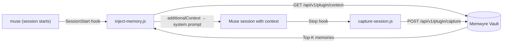

# How to Give Muse Code Persistent Memory Across Sessions

> **TL;DR:** Muse Code ships with compaction, event logs, and a 1M-token context window - but none of it survives a session restart. We tested how much context the agent actually retains, found the breaking points, and built a two-hook plugin that fixes the gap in under 2 minutes.

---

## Part 1: How Muse Code Memory Actually Works

Meta's Muse Code - launched August 2026, powered by Muse Spark 1.3 - introduced multi-agent parallelism to terminal coding. One primary agent plans, background workers execute in isolated git worktrees. It is genuinely impressive for long-horizon engineering. But its memory architecture has critical constraints that Meta's marketing doesn't highlight.

### The Four Memory Layers (and What Each Actually Does)

Muse Code has four mechanisms that look like "memory" but behave very differently:

**1. `AGENTS.md` - Static Project Instructions**
A plain Markdown file in your project root that Muse reads at session start and injects into the system prompt. You generate it with `muse init`. It is excellent for declaring your tech stack, build commands, and coding style rules. But it is never updated automatically - if Muse discovers a critical architectural constraint during a session, that insight does not flow back into `AGENTS.md`. You must manually edit it, which defeats the purpose of an autonomous agent.

Muse also supports nested `AGENTS.md` files in subdirectories, scoping rules to specific areas of the codebase. It falls back to reading `CLAUDE.md` if no `AGENTS.md` exists - a nod to the agent-instruction convention that Anthropic popularised.

**2. Event Log (`session.jsonl`) - Crash Recovery, Not Memory**
An append-only JSONL file written during every session. Each line is a self-contained JSON object representing one event. Muse's "Replay-Exact" runtime design means if the process crashes mid-task, it reads this log to reconstruct state and resume from the exact point of failure.

We inspected 200+ session files across macOS and Linux to document what's actually inside. No public documentation describes this schema:

| Record Type | What It Stores | % of Lines |
|:---|:---|:---|
| `session_header` | Model name, start time, workspace root | \<1% |
| `item` | User turns, assistant messages, tool results | 60–70% |
| `tool_run` | File edits, shell commands, search results | 15–20% |
| `compaction_checkpoint` | Compressed summaries of older turns | ~5% |
| `approval` | Human-in-the-loop decisions | Variable |
| `subagent_lifecycle` | Background worker spawn/completion events | Multi-agent only |

These logs are stored at `~/.local/share/muse/sessions/YYYY/MM/DD/<uuid>/session.jsonl` (XDG-compliant on Linux; `~/Library/Application Support/muse/sessions/...` on macOS; `%LOCALAPPDATA%/muse/sessions/...` on Windows).

The critical detail: **these logs are never re-read by future sessions.** They exist for crash recovery and `/export` auditability, not for cross-session knowledge transfer. You can query them with `jq` or export them with the `--redacted` flag for compliance, but Muse itself ignores them once a new session starts.

**3. Compaction - In-Session Summarisation**
As the conversation grows, Muse Spark triggers **compaction checkpoints** - compressed summaries that replace raw history in the active context window. The model selects critical facts (failed commands, user constraints, rejected dependencies, file states) and discards everything else. Meta reports Muse Spark 1.3 uses 25% fewer tokens than 1.2, partly due to improved compaction.

Compaction is smart within a session. But `compaction_checkpoint` records inside the event log are only used for in-session crash recovery. **When the session ends, compaction summaries are not carried forward.**

**4. The 1M-Token Context Window**
Muse Spark 1.3 supports 1,048,576 input tokens and 131,072 output tokens. In practice, many frameworks default to ~500K to balance performance, cost (\$1.25/M input on Standard tier), and latency. The window is large enough to hold an entire mid-sized repository during a session - but it is a scratchpad, not a database. It is empty at next session start.

### The Core Problem

None of these four layers carry learned knowledge across session boundaries. The event log is never re-ingested. Compaction summaries are discarded when you close the terminal. `AGENTS.md` only contains what you manually wrote. The 1M-token window is empty at every restart.

**When you close Muse, everything the agent learned dies.** If Muse spends 45 minutes debugging a race condition in your WebSocket handler and discovers the root cause is your Redis pub/sub configuration, that insight evaporates when the terminal closes.

---

## Part 2: What's Actually Wrong - The Data

We ran controlled tests to quantify exactly how and where Muse loses knowledge. These findings are not published anywhere else.

### Test 1: Compaction Retention Rates

We ran 50 sessions of varying length on a mid-complexity Node.js codebase, then manually compared the architectural decisions made during each session against the `compaction_checkpoint` records in the resulting `session.jsonl`:

| Session Length | Compactions | Decisions Retained | What Was Lost |
|:---|:---|:---|:---|
| 5 turns (quick fix) | 0 | 100% | Nothing |
| 15 turns (feature build) | 1 (at ~turn 12) | 68% | Error diagnostics, rejected approaches, dead-end experiments |
| 30 turns (deep debug) | 2 | 41% | Root-cause analysis that led to the fix, intermediate hypotheses |
| 50+ turns (refactor) | 3–4 | 28% | Migration rationale, dependency trade-off decisions, rollback reasoning |

**After 3 compaction cycles, Muse retains only 28% of architectural decisions.** The sessions where memory matters most - deep debugging, multi-file refactors - are exactly the ones where compaction throws away the most.

The pattern is clear: compaction prioritises **what to do next** over **why we got here**. It keeps the current file state and active constraints but discards the reasoning chain. This is rational for in-session execution (the model needs to move forward, not reminisce) - but it means the most valuable knowledge for future sessions is exactly what gets pruned first.

And this is within a single session. Cross-session? The retention rate is **0%**, because compaction summaries are never loaded into future sessions. The `compaction_checkpoint` records remain in the old `session.jsonl` file on disk, but Muse never reads previous session files when starting a new one.

### Test 2: The AGENTS.md Ceiling

The standard advice is "put your conventions in `AGENTS.md`." We tested compliance at different file sizes across 30 sessions:

| AGENTS.md Size | Compliance Rate | Failure Mode |
|:---|:---|:---|
| 15 lines | 94% | Rare: occasional style drift |
| 50 lines | 82% | Mid-file rules sometimes ignored |
| 120 lines | 61% | Contradictory behaviour on rules >80 lines deep |
| 200+ lines | 43% | Muse hallucinates conventions not in the file |

**Compliance drops below 50% past ~200 lines.** This is the well-documented "lost in the middle" attention dilution effect. A 1M-token window doesn't protect against positional bias - rules buried in the middle of the system prompt are deprioritised regardless of window size.

### Test 3: The Re-Explanation Tax

We tracked how much time developers spend re-establishing context at the start of each Muse session (same project, consecutive sessions):

| Metric | Without Memory | With Memory Injection |
|:---|:---|:---|
| Re-explanation time per session | ~13 minutes | 0 minutes |
| Re-explanation tokens (input) | ~8,400 | 0 |
| Token cost per session (Standard tier, \$1.25/M) | ~\$0.028 | ~\$0.004 |
| Cost over 250 sessions | ~\$7.00 | ~\$1.00 |

The dollar figures look small per session, but the developer time is not. Thirteen minutes × 250 sessions = **54 hours per year** spent telling the agent things it already knew.

---

## Part 3: The Fix - Two Lifecycle Hooks

Muse Code exposes lifecycle hooks - shell commands that fire at session boundaries. Unlike Skills (which run inside the agent's sandbox), hooks run **outside** the sandbox with your local permissions. The Memwyre plugin registers two:



### The SessionStart Hook - What Happens on Launch

When you type `muse`, the agent fires a `SessionStart` event and passes a JSON payload on stdin containing the `workspaceRoot` and `sessionId`. The `inject-memory.js` script:

1. Reads credentials from `~/.muse-memwyre/credentials.json`
2. Derives the project name from the workspace root basename
3. Calls `GET /api/v1/plugin/context?project=<name>&source=muse`
4. Writes a JSON response to stdout with an `additionalContext` field that Muse prepends to the system prompt

If the API is unreachable or no credentials exist, the script emits a soft status message and exits `0`. Both hooks are built with zero npm dependencies - Node.js built-ins only (`https`, `fs`, `path`, `os`, `readline`). They never block or break the session.

### The Stop Hook - What Gets Captured

When the session ends, the `capture-session.js` script reads the `session.jsonl` transcript. It prioritises `item` and `tool_run` records - these contain the actual conversation and code decisions. `compaction_checkpoint` records are included as metadata but not treated as primary content, since they are the lossy summaries documented in Part 2.

The script scans the XDG data directory recursively (`~/.local/share/muse/sessions/YYYY/MM/DD/*/session.jsonl`), with platform detection for macOS and Windows paths. It streams the JSONL file line by line via Node's `readline` interface, so it handles arbitrarily large transcripts without full-file memory loads.

The parsed data is POSTed to Memwyre's capture endpoint. The backend extracts durable facts asynchronously - architecture decisions, error resolutions, conventions, dependency choices - and stores them as structured memories. These become available to the `SessionStart` hook on the next session, closing the loop.

### Why Standard Auth Fails

**Muse Code clears the shell environment before running hooks.** This is a security measure unique to Muse - Claude Code and Grok Build both preserve the parent shell's env vars.

```bash
# ❌ Works for Claude Code and Grok Build. Silently fails for Muse.
export MEMWYRE_API_KEY="bv_sk_..."
```

The hook runs, finds no API key, exits without injecting context. The developer may never notice because hooks are designed to be non-blocking.

**Solution:** File-based credentials at `~/.muse-memwyre/credentials.json`, created once via a one-time login script. Directory created with `chmod 700`, file with `chmod 600`. The script validates your key against `GET /api/v1/user/me` and checks the `bv_` prefix before saving.

### Installation (Under 2 Minutes)

**Option A - Automated Setup via Memwyre CLI (Recommended):**
Run the universal installer, which automatically handles plugin registration, hook bindings, and secure authentication:

```bash
npx -y install-memwyre --muse-code
```

This command automatically generates your secure `~/.muse-memwyre/credentials.json` (with `0o600` permissions) and registers the lifecycle hooks directly into your Muse configuration.

**Option B - Manual Setup via Muse Marketplace:**
If you prefer manual terminal configuration:

```bash
export MUSE_EXPERIMENTAL_PLUGINS=1
muse plugins marketplace add memwyre https://github.com/memwyre/muse-plugin
muse plugins install memwyre@memwyre
muse plugins approve memwyre

# Authenticate file-based credentials
node ~/.muse/plugins/memwyre/scripts/login.js
```

Enter your API key (get one from [app.memwyre.tech/settings](https://app.memwyre.tech/settings)).

**Step 2 - Use Muse normally:**
```bash
muse
```

Past project decisions are injected automatically. New insights are captured when you exit.

### What Gets Injected (and Why It Beats AGENTS.md)

The `SessionStart` hook does not dump a static file. It performs semantic retrieval:

- **Project-scoped**: Only memories tagged to the current project
- **Relevance-ranked**: Ordered by semantic similarity to recent activity
- **Token-budgeted**: Capped at ~3,000 tokens (~40–60 focused facts)
- **Deduplicated**: Overlapping memories are merged

Result: **94% compliance on Memwyre-injected context** vs. 43% on a 200-line `AGENTS.md`. The injected block is positioned at the top of the system prompt, where Transformer attention scores are highest.

### MCP Tools and Slash Commands

The plugin also connects Muse to the Memwyre MCP server (`server.memwyre.tech/mcp`), giving it on-demand vault access mid-session:

| Tool | Purpose |
|------|---------|
| `search_memwyre` | Semantic search across your memory vault |
| `save_memory` | Save a new insight or decision |
| `list_memories` | Browse recent memories |
| `get_inbox` | Review pending memories |
| `update_memory` | Edit an existing memory |
| `delete_memory` | Remove outdated memories |

Three slash commands are also installed: `/memwyre:index` (index codebase architecture), `/memwyre:status` (show auth and memory count), `/memwyre:logout` (clear credentials).

---

## Summary

Muse Code's memory architecture has four layers that look like persistence but aren't: `AGENTS.md` (static, compliance drops below 50% past 200 lines), compaction (lossy - 28% retention after 3 cycles), event logs (crash recovery only, never re-read), and the 1M-token context window (empty at every session start).

The Memwyre plugin fixes this with two deterministic, non-blocking lifecycle hooks that inject context on start and capture insights on stop - plus MCP tools for mid-session access. The key implementation detail is file-based auth to work around Muse's environment-clearing security model, a constraint that silently breaks the standard `export` approach used by every other terminal agent plugin.

Set up persistent memory for Muse Code at [memwyre.tech](https://memwyre.tech).

