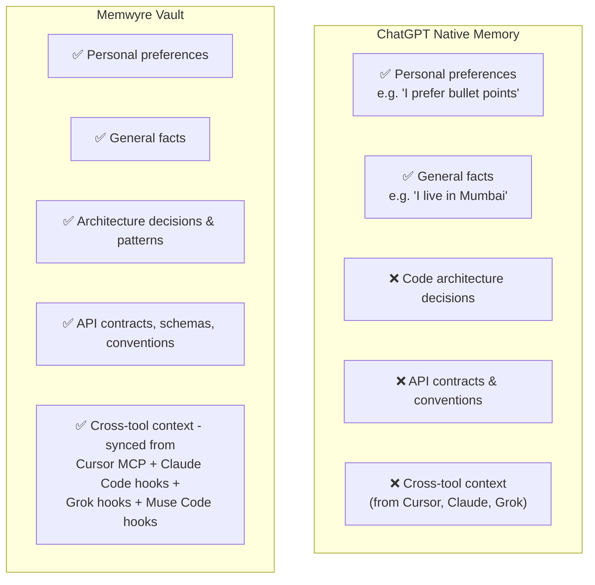
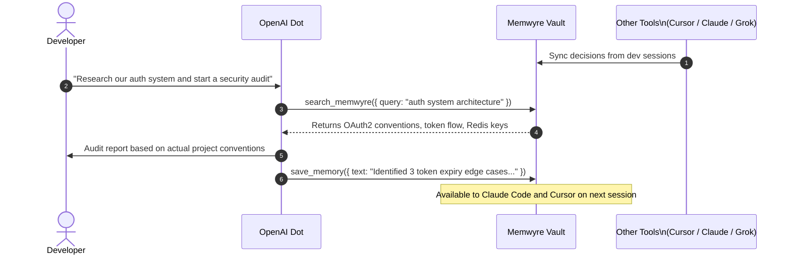

# How to Give OpenAI Dots Persistent Memory with Memwyre

> **TL;DR:** OpenAI Dots (announced September 2026) are always-on ChatGPT agents powered by GPT-6 Astra. They manage their own cloud computers, browsers, and task queues - but their built-in memory is a consumer-grade silo disconnected from your developer tools. By connecting Memwyre's MCP server to ChatGPT, your Dots gain access to a structured, cross-tool memory vault that syncs with Claude Code, Cursor, Grok, and Muse Code - giving them true institutional memory about your projects.

---

## What Are OpenAI Dots?

Announced at OpenAI DevDay on September 29, 2026, **Dots** are persistent AI agents that live inside ChatGPT, Slack, and Microsoft Teams. Unlike standard ChatGPT conversations that end when you close the tab, a Dot:

- **Runs continuously** - it works in the background even when you're offline
- **Has its own cloud computer** - can browse the web, run code, and manage files
- **Manages ongoing tasks** - tracks project status, monitors deadlines, and follows up autonomously
- **Delegates to subagents** - spawns background agents for parallel workstreams

This makes Dots ideal for long-running research, project management, monitoring, and coordination tasks.

---

## The Memory Problem with Dots

Dots have access to ChatGPT's native memory system, but that system was designed for **consumer preferences**, not **developer project knowledge**:

---

## The Solution: Memwyre MCP + OpenAI Dots

The Memwyre MCP server (already live at `server.memwyre.tech/mcp`) provides a structured memory API that any MCP-compatible client - including ChatGPT's connected app ecosystem - can use.

Once connected, your Dot can:

- **Search** past decisions made in any of your connected tools
- **Save** new insights from Dot sessions back to your shared vault
- **Cross-reference** context across your entire AI developer stack
- **Share knowledge** with other Dots connected to the same vault

---

## Setup: Connect Memwyre to ChatGPT Dots

### Step 1: Generate Your API Key

1. Go to [app.memwyre.tech/settings](https://app.memwyre.tech/settings)
2. Click **API Keys → Generate New Key**
3. Copy the key (format: `bv_sk_...`)

### Step 2: Add Memwyre as a Connected App

In ChatGPT:
1. Enable **Developer Mode** in your ChatGPT settings (required for custom MCP connections)
2. Click your profile → **Settings**
3. Navigate to **Connected Apps** (or **Integrations**)
4. Click **+ Add MCP Server**
5. Enter:
  - **Name:** Memwyre Memory Vault
  - **URL:** `https://server.memwyre.tech/mcp`
  - **Auth Type:** Bearer Token
  - **Token:** Your `bv_sk_...` API key

> **Production note:** For multi-user or enterprise deployments, OpenAI requires OAuth 2.1 with PKCE instead of static Bearer tokens. The static token approach works for personal use. Contact support@memwyre.tech for OAuth integration guidance.

### Step 3: Enable for Your Dot

1. Open your Dot's configuration
2. Under **Capabilities**, find and enable **Memwyre Memory Vault**
3. Optionally, add a standing instruction to your Dot:

> *"Before starting any project task, search Memwyre for existing decisions and context about that project. After completing research or analysis, save a summary to Memwyre for future reference."*

### ⚠️ Read-Only Proactive Mode

When your Dot operates autonomously in the background (proactive mode), OpenAI enforces a strict **read-only restriction**:

- **Read tools work normally:** `search_memwyre`, `list_memories`, `get_inbox`
- **Write tools are staged:** `save_memory`, `update_memory`, `delete_memory` will be queued and require your explicit approval before executing

This is an OpenAI platform safety constraint and cannot be bypassed with Custom Rules.

---

## Available Memwyre Tools for Dots

| Tool | When to Use |
|------|-------------|
| `search_memwyre` | Look up past decisions, patterns, and context |
| `save_memory` | Store new findings, decisions, and notes |
| `list_memories` | Browse recent memories (useful for orientation) |
| `get_inbox` | Review memories pending your approval |
| `update_memory` | Correct or update an existing memory |
| `delete_memory` | Remove outdated or incorrect memories |
| `search_by_date` | Find what was decided in a specific time period |
| `generate_prompt` | Generate a context-enriched prompt for a task |

---

## Real-World Use Cases

### 1. Project Kickoff Researcher Dot
Configure a Dot to run at 9 AM every weekday:
> *"Search Memwyre for all memories tagged with today's active project. Prepare a morning briefing with: current status, open decisions, next actions."*

The Dot surfaces all context from your previous sessions across all tools - no manual catch-up needed.

### 2. Architecture Review Dot
Before implementing a new feature:
> *"Search Memwyre for conventions related to [feature area]. Check for existing patterns, anti-patterns, and agreed standards. Report any conflicts with the proposed implementation."*

### 3. Cross-Team Knowledge Bridge
When a new developer joins a project, their Dot can onboard them automatically:
> *"Search Memwyre for project conventions, setup guides, and architectural decisions. Summarize the most important things for a new developer to know."*

---

## How This Compares to Native ChatGPT Memory

| Capability | ChatGPT Native Memory | Memwyre Vault |
|-----------|----------------------|--------------|
| Cross-tool sync (Cursor, Claude, Grok) | ❌ | ✅ |
| Structured code knowledge | ❌ | ✅ |
| Team/multi-user sharing | ❌ | ✅ |
| API-queryable | ❌ | ✅ |
| Inbox curation & approval | ❌ | ✅ |
| Tagged & searchable | Limited | ✅ |
| Context window efficiency | Uncontrolled | ✅ Semantic top-K retrieval |

---

## Privacy & Security

All communication between ChatGPT and Memwyre happens over HTTPS (TLS 1.3). Your API key is sent as a Bearer token per request - it is never cached by the MCP server. Memory data is encrypted at rest (AES-256). See [memwyre.tech/privacy](https://memwyre.tech/privacy).

---

## Get Started

Connect your Dots to Memwyre in under 2 minutes:

1. **Get an API key:** [app.memwyre.tech/settings](https://app.memwyre.tech/settings)
2. **Connect MCP:** ChatGPT → Settings → Connected Apps → `https://server.memwyre.tech/mcp`
3. **Configure your Dot** to use Memwyre as its project memory backend

